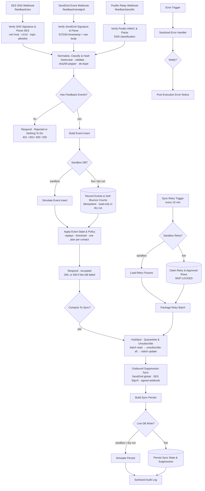

# n8n-smtp-relay-bounce-complaint-feedback-loop

**One n8n workflow that receives hard bounces, soft bounces and spam complaints from Amazon SES, SendGrid and your own Postfix relay. It verifies every request, stores each event once, and quarantines the contact: in HubSpot, in a PostgreSQL suppression list, and in your sending systems.**

I built this for teams who send from more than one place: SES for product mail, SendGrid for campaigns, a Postfix relay for sequences. When a mailbox hard-bounces or someone hits "report spam", every one of those systems and the CRM should stop mailing that address. Usually only the system that saw the event knows. That's how sender reputation gets damaged by the next campaign from a different tool.

The workflow closes that loop:
- It **quarantines** the contact immediately with reversible flags.
- It **suppresses** the address in your outbound systems.
- It **unsubscribes** the contact in HubSpot, either after a person approves it (the default) or straight away.

> **Safe by default.** `SANDBOX_MODE=true`, `DRY_RUN=true`, `CONSENT_CHANGE_MODE=review`. Out of the box, it only uses pinned, fictional, correctly signed provider requests. Sandbox makes no outside calls. Dry run reads HubSpot and PostgreSQL but writes nothing. Review mode never changes marketing consent until a person approves it.

Built by DH Robin, Revenue Infrastructure Architect · dhRobin Systems · MIT licensed.

---

## Table of Contents

1. [What it does](#1-what-it-does)
2. [Architecture](#2-architecture)
3. [Repository layout](#3-repository-layout)
4. [Prerequisites](#4-prerequisites)
5. [PostgreSQL state & suppression schema](#5-postgresql-state--suppression-schema)
6. [Webhook endpoint security](#6-webhook-endpoint-security)
7. [Connecting the providers](#7-connecting-the-providers)
8. [Classification & policy](#8-classification--policy)
9. [HubSpot: quarantine, unsubscribe, marketing status](#9-hubspot-quarantine-unsubscribe-marketing-status)
10. [Suppression list synchronization](#10-suppression-list-synchronization)
11. [Consent review & retries](#11-consent-review--retries)
12. [Environment variables](#12-environment-variables)
13. [Node configuration guide](#13-node-configuration-guide)
14. [Deployment steps & testing stages](#14-deployment-steps--testing-stages)
15. [Sanitized audit logging & privacy](#15-sanitized-audit-logging--privacy)
16. [Troubleshooting](#16-troubleshooting)
17. [Known limitations](#17-known-limitations)
18. [Disclaimer & license](#18-disclaimer--license)

---

## 1. What it does

| Signal | From | Default result |
|---|---|---|
| Spam complaint | SES `Complaint`, SendGrid `spamreport`, Postfix FBL (ARF) | **Quarantine** + suppress in SendGrid / SES / webhook + unsubscribe-all in HubSpot (review) |
| Hard bounce | SES `Permanent`, SendGrid `bounce` / `dropped: Bounced Address`, Postfix `dsn=5.x.x` | **Quarantine** + suppress + unsubscribe (review) |
| Unsubscribe | SendGrid `unsubscribe` / `dropped: Unsubscribed Address`, Postfix structured event | **Quarantine** + suppress + unsubscribe (review) |
| Repeated soft bounces | 3 soft bounces in 7 days (any mix of providers) | **Quarantine** (soft), no consent change, no outbound suppression |
| Single soft bounce, block | SES `Transient`, SendGrid `deferred` / `blocked`, Postfix `4.x.x` / `5.7.x` | Recorded only, counts toward the threshold |
| Group unsubscribe | SendGrid `group_unsubscribe` | Recorded only (SendGrid already handles the group) |
| Delivery, open, click, `not-spam` | any | Counted and ignored |

The provider gets **200 only after the event is stored**. If PostgreSQL is down, the answer is 500, so SNS and SendGrid retry.

## 2. Architecture



| Required component | Nodes |
|---|---|
| Inbound webhook ingestion (SES/SNS, SendGrid, Postfix) | `SES SNS Webhook`, `SendGrid Event Webhook`, `Postfix Relay Webhook` |
| Payload verification & signature validation | `Verify SNS Signature & Parse SES`, `Verify SendGrid Signature & Parse`, `Verify Postfix HMAC & Parse` |
| Email normalization & hashing | `Normalize, Classify & Hash` |
| HubSpot CRM property updates (quarantine flags, marketing status, lifecycle stage, unsubscribe) | `HubSpot · Quarantine & Unsubscribe` |
| Suppression list synchronization | `Record Events & Soft-Bounce Counts`, `Persist Sync State & Suppression`, `Outbound Suppression Sync` |
| Sanitized audit logging | `Normalize, Classify & Hash`, `Apply Event State & Policy`, `Sanitized Audit Log`, `Sanitized Error Handler` |

**Why the provider calls live in Code nodes.** HubSpot, SendGrid, SES and the webhook are called with n8n's built-in HTTP helper. That keeps the batch on one straight path (no branch merges, exactly one webhook answer) and lets each step batch its calls (100 contacts per HubSpot call, 500 per SendGrid call), retry on 429/5xx, and record a status per contact and target.

## 3. Repository layout

```
n8n-smtp-relay-bounce-complaint-feedback-loop/
├── README.md        ← this file (includes the PostgreSQL schema)
├── workflow.json    ← import into n8n (inactive, sandbox defaults, pinned fixtures)
├── DISCLAIMER.md
└── LICENSE          ← MIT
```

## 4. Prerequisites

| Item | Notes |
|---|---|
| n8n | 1.x, with `N8N_BLOCK_ENV_ACCESS_IN_NODE=false` and `NODE_FUNCTION_ALLOW_BUILTIN=crypto` |
| Code-node HTTP helper | The verify, HubSpot and outbound steps call `this.helpers.httpRequest` from Code nodes. If your n8n build doesn't expose it, SNS certificate downloads fail (503, SNS retries) and syncs stay `pending`. Nothing is silently marked done. Check it in Stage 2. |
| PostgreSQL | 12 or newer, with the schema in section 5 and a least-privilege role |
| HubSpot | A private app token (`YOUR_HUBSPOT_TOKEN`) with scopes `crm.objects.contacts.read`, `crm.objects.contacts.write` and `communication_preferences.statuses.batch.write`, plus `crm.schemas.contacts.write` once, to create the properties |
| Providers | Any of SES (SNS topic + IAM key for the suppression list), SendGrid (Event Webhook + API key), Postfix (a log shipper that can sign requests) |
| Public HTTPS | SNS and SendGrid must reach `https://YOUR_N8N_HOST/webhook/feedback/…` |
| Workflow settings | Settings → Error Workflow = this workflow |

## 5. PostgreSQL state & suppression schema

Run once (`psql "YOUR_POSTGRES_URL" -f schema.sql`, or paste into your SQL client):

```sql
-- n8n-smtp-relay-bounce-complaint-feedback-loop · PostgreSQL schema
-- DH Robin, Revenue Infrastructure Architect · dhRobin Systems · MIT
-- Addresses are stored as sha256(EMAIL_HASH_PEPPER + lowercase email).
-- The plaintext address lives only in contact_sync_state.email, and only
-- while a sync is pending or waiting for review (or with STORE_EMAIL_PLAINTEXT=true).

CREATE OR REPLACE FUNCTION feedback_severity_rank(t text) RETURNS int
LANGUAGE sql IMMUTABLE AS $$
  SELECT CASE t WHEN 'complaint' THEN 5 WHEN 'hard_bounce' THEN 4 WHEN 'unsubscribe' THEN 3
                WHEN 'soft_bounce_threshold' THEN 2 WHEN 'blocked' THEN 1 WHEN 'soft_bounce' THEN 1 ELSE 0 END $$;

-- Every accepted provider event, once (idempotency key: source + event_id)
CREATE TABLE IF NOT EXISTS feedback_events (
  id                  bigserial PRIMARY KEY,
  source              text        NOT NULL CHECK (source IN ('ses', 'sendgrid', 'postfix')),
  event_id            text        NOT NULL,
  event_type          text        NOT NULL,
  email_hash          char(64)    NOT NULL,
  email_domain        text,
  occurred_at         timestamptz NOT NULL,
  received_at         timestamptz NOT NULL DEFAULT now(),
  provider_message_id text,
  detail              jsonb       NOT NULL DEFAULT '{}'::jsonb,
  run_id              text,
  sync_status         text        NOT NULL DEFAULT 'recorded',  -- recorded · pending · review · done
  synced_at           timestamptz,
  UNIQUE (source, event_id)
);
CREATE INDEX IF NOT EXISTS feedback_events_hash_type_idx ON feedback_events (email_hash, event_type, occurred_at DESC);

-- The quarantine list (internal suppression), one row per mailbox
CREATE TABLE IF NOT EXISTS email_suppression (
  email_hash     char(64) PRIMARY KEY,
  email_domain   text,
  reason         text        NOT NULL,              -- highest severity seen
  sources        text[]      NOT NULL DEFAULT '{}',
  event_count    int         NOT NULL DEFAULT 0,
  quarantined    boolean     NOT NULL DEFAULT true,
  first_seen_at  timestamptz NOT NULL DEFAULT now(),
  last_seen_at   timestamptz NOT NULL DEFAULT now(),
  released_at    timestamptz,
  released_by    text,
  release_note   text
);

-- Sync state per contact: HubSpot, SendGrid, SES, webhook, consent
CREATE TABLE IF NOT EXISTS contact_sync_state (
  email_hash          char(64) PRIMARY KEY,
  email_domain        text,
  email               text,                          -- NULL once everything is done
  severity            text        NOT NULL,
  reasons             text[]      NOT NULL DEFAULT '{}',
  sources             text[]      NOT NULL DEFAULT '{}',
  hubspot_contact_id  text,
  hubspot_status      text,       -- updated · not_found · failed · not_configured · disabled
  sendgrid_status     text,       -- done · failed · skipped · not_configured
  ses_status          text,
  webhook_status      text,
  unsubscribe_state   text        NOT NULL DEFAULT 'not_requested',
                                  -- not_requested · pending_review · approved · applied · rejected · failed · not_applicable
  overall_status      text        NOT NULL DEFAULT 'pending',   -- pending · review · done · failed
  attempts            int         NOT NULL DEFAULT 0,
  last_error          text,
  next_attempt_at     timestamptz NOT NULL DEFAULT now(),
  claimed_at          timestamptz,
  reviewed_by         text,
  reviewed_at         timestamptz,
  created_at          timestamptz NOT NULL DEFAULT now(),
  updated_at          timestamptz NOT NULL DEFAULT now()
);
CREATE INDEX IF NOT EXISTS contact_sync_state_due_idx ON contact_sync_state (overall_status, next_attempt_at);
CREATE INDEX IF NOT EXISTS contact_sync_state_unsub_idx ON contact_sync_state (unsubscribe_state);

-- One row per run
CREATE TABLE IF NOT EXISTS feedback_runs (
  run_id      text PRIMARY KEY,
  origin      text NOT NULL,               -- ses · sendgrid · postfix · retry
  mode        text NOT NULL,
  started_at  timestamptz,
  finished_at timestamptz NOT NULL DEFAULT now(),
  counts      jsonb NOT NULL DEFAULT '{}'::jsonb
);

-- Unsubscribes waiting for a person (CONSENT_CHANGE_MODE=review)
CREATE OR REPLACE VIEW consent_review_queue AS
SELECT email_hash, email_domain, email, severity, reasons, sources, hubspot_contact_id, created_at, updated_at
  FROM contact_sync_state
 WHERE unsubscribe_state = 'pending_review';

-- Everything currently quarantined
CREATE OR REPLACE VIEW active_quarantine AS
SELECT s.email_hash, s.email_domain, s.reason, s.sources, s.event_count, s.first_seen_at, s.last_seen_at,
       c.overall_status, c.unsubscribe_state, c.hubspot_status, c.sendgrid_status, c.ses_status
  FROM email_suppression s
  LEFT JOIN contact_sync_state c USING (email_hash)
 WHERE s.quarantined;

-- Least-privilege role for the n8n credential (run as an admin, then uncomment):
-- CREATE ROLE n8n_feedback LOGIN PASSWORD 'YOUR_POSTGRES_PASSWORD';
-- GRANT SELECT, INSERT, UPDATE ON feedback_events, email_suppression, contact_sync_state, feedback_runs TO n8n_feedback;
-- GRANT SELECT ON consent_review_queue, active_quarantine TO n8n_feedback;
-- GRANT USAGE ON SEQUENCE feedback_events_id_seq TO n8n_feedback;
-- GRANT EXECUTE ON FUNCTION feedback_severity_rank(text) TO n8n_feedback;
```

| Table / view | Purpose |
|---|---|
| `feedback_events` | Every accepted event once, by `(source, event_id)`. Hash, domain, type, DSN and trimmed diagnostic only, **never the address**. It also drives the soft-bounce window. |
| `email_suppression` | The internal quarantine list: one row per mailbox (hash), with the highest severity seen, sources, counts and release columns. |
| `contact_sync_state` | Per contact: the outcome for HubSpot, SendGrid, SES and the webhook, the consent state, attempts and backoff. It holds the plaintext address **only while something is pending or in review**. |
| `feedback_runs` | One summary row per run |
| `consent_review_queue` | Unsubscribes waiting for a person |
| `active_quarantine` | Everything currently quarantined, with its sync state |

**n8n credential:** create a **Postgres** credential from the parts of `YOUR_POSTGRES_URL` and select it on the three Postgres nodes. They ship with the placeholder `YOUR_POSTGRES_CREDENTIAL_ID`. Use the least-privilege role at the end of the schema. Parameters are passed base64-encoded, so commas inside JSON can't break n8n's query-parameter list.

**The three statements:**
- **Record Events & Soft-Bounce Counts:** `INSERT … ON CONFLICT (source, event_id) DO NOTHING`. It then returns, per event, whether it is new, the prior soft bounces in the window, and the current quarantine and sync state. In `DRY_RUN` it inserts nothing and only checks for existing rows.
- **Claim Retry & Approved Rows:** `UPDATE … WHERE … FOR UPDATE SKIP LOCKED RETURNING`. It claims rows that are due for retry, plus approved unsubscribes. Claims older than 30 minutes are reclaimed.
- **Persist Sync State & Suppression:** one statement with data-modifying CTEs:
  - upserts the quarantine row (keeps the higher severity);
  - upserts the sync state (exponential backoff, `failed` after `SYNC_MAX_ATTEMPTS`, an `applied` unsubscribe never goes back);
  - updates the event status and writes the run row.
  
  Replaying the same run writes nothing.

## 6. Webhook endpoint security

Every endpoint fails closed. With `SANDBOX_MODE=false`, a missing secret, key or allowlist answers 500 and processes nothing.

| Endpoint | Check | Rejection |
|---|---|---|
| `POST /webhook/feedback/ses` | SNS signature over the fixed field list (`SignatureVersion` 1 = SHA1, 2 = SHA256). The certificate comes only from `https://sns.<region>.amazonaws.com/….pem` and is cached `SNS_CERT_CACHE_HOURS` (24). `TopicArn` must be in `SNS_ALLOWED_TOPIC_ARNS`. The message-type header must match. `SubscribeURL` must be an AWS host. | 401 bad signature or certificate URL · 403 foreign topic · 503 certificate download failed (SNS retries) |
| `POST /webhook/feedback/sendgrid` | ECDSA P-256 / SHA-256 over `X-Twilio-Email-Event-Webhook-Timestamp + raw body`, checked with `SENDGRID_WEBHOOK_PUBLIC_KEY` (base64 DER or PEM). Optional timestamp age check (`SENDGRID_MAX_TIMESTAMP_AGE_SECONDS`, off by default because SendGrid retries for up to 24 hours). Replays are harmless: `sg_event_id` is the idempotency key. | 401 · 400 not an array · 413 too many events |
| `POST /webhook/feedback/postfix` | `X-Signature: sha256=hex(HMAC-SHA256(POSTFIX_WEBHOOK_SECRET, X-Timestamp + "." + raw body))`, with a 300-second window | 401 · 400 · 413 |

Also recommended:
- Keep **Raw Body** on for all three webhooks (it already is). A re-serialized body won't match a signature.
- Put the endpoints behind your reverse proxy's rate limit.
- Restrict `/feedback/postfix` to your relay's IP addresses.
- n8n webhook nodes also support header or basic auth if you want a second factor on the Postfix path.

## 7. Connecting the providers

### 7.1 Amazon SES (via SNS)

1. Create an SNS topic, for example `ses-feedback`, and put its ARN in `SNS_ALLOWED_TOPIC_ARNS`. The value can be a comma-separated list.
2. In SES, send **Bounce** and **Complaint** notifications for your identities to that topic, or use a configuration set event destination for Bounce/Complaint events. Both formats are understood (`notificationType` or `eventType`).
3. Add an **HTTPS** subscription to `https://YOUR_N8N_HOST/webhook/feedback/ses` with **raw message delivery off**. The workflow needs the signed SNS envelope.
4. **Confirm the subscription:**
   - **Live mode:** the workflow confirms it automatically (`SNS_AUTO_CONFIRM_SUBSCRIPTION=true`).
   - **Dry run:** it does not confirm. Confirm from the SNS console, or re-request confirmation once you go live.
5. For the suppression-list sync, give an IAM user or role only `ses:PutSuppressedDestination`:
   ```json
   { "Version": "2012-10-17", "Statement": [{ "Effect": "Allow", "Action": "ses:PutSuppressedDestination", "Resource": "*" }] }
   ```

### 7.2 SendGrid

1. **Settings → Mail Settings → Event Webhook:** set the HTTP POST URL to `https://YOUR_N8N_HOST/webhook/feedback/sendgrid`. Select *Bounced, Dropped, Deferred, Spam Reports, Unsubscribes, Group Unsubscribes*.
2. Turn on the **Signed Event Webhook** and copy the verification key into `SENDGRID_WEBHOOK_PUBLIC_KEY`.
3. For the suppression sync, create an API key with **Suppressions** access (`YOUR_SENDGRID_API_KEY`). EU regional subusers set `SENDGRID_API_BASE_URL=https://api.eu.sendgrid.com`.

`bounce` events with a `bounce_classification` of Technical, Content, Reputation or "Frequency or Volume Too High" are treated as **blocks** (a sender-side problem), not as invalid mailboxes. Change this with `SENDGRID_SOFT_BOUNCE_CLASSIFICATIONS`.

### 7.3 Postfix relay

Postfix has no webhook, so a small shipper sends delivery log lines and parsed FBL complaints. Any tool that can sign requests works (Vector, Fluent Bit, cron). A minimal Python shipper:

```python
# ship_postfix.py: run from cron or a log follower; sends bounced/deferred lines
import hashlib, hmac, json, os, time, urllib.request
SECRET = os.environ["POSTFIX_WEBHOOK_SECRET"].encode()          # YOUR_WEBHOOK_SECRET
URL = "https://YOUR_N8N_HOST/webhook/feedback/postfix"
def ship(lines, events=()):
    body = json.dumps({"host": os.uname().nodename, "lines": list(lines), "events": list(events)}, separators=(",", ":"))
    ts = str(int(time.time()))
    sig = hmac.new(SECRET, f"{ts}.{body}".encode(), hashlib.sha256).hexdigest()
    req = urllib.request.Request(URL, data=body.encode(), method="POST",
          headers={"Content-Type": "application/json", "X-Timestamp": ts, "X-Signature": f"sha256={sig}"})
    with urllib.request.urlopen(req, timeout=15) as r:
        return r.status
# example: ship([l for l in open("/var/log/mail.log") if "status=bounced" in l or "status=deferred" in l][-500:])
```

The body has `lines` (raw `postfix/smtp` lines with `to=<…>`, `dsn=` and `status=`) and/or `events`. Event types are `complaint`, `bounce`, `deferred` and `unsubscribe`, with `recipient`, `dsn`, `status`, `queue_id`, `feedback_type` and `id`. Lines are de-duplicated by host, queue ID, recipient, DSN and status, so re-sending a log window is safe.

## 8. Classification & policy

**Severity order:** `complaint` > `hard_bounce` > `unsubscribe` > `soft_bounce_threshold` > `blocked` / `soft_bounce` > `group_unsubscribe`. When one contact has several events in a batch, the highest severity decides.

| Postfix DSN | Type |
|---|---|
| `5.2.2` (mailbox full) | soft bounce |
| `5.7.x` (policy, reputation) | blocked |
| other `5.x.x`, or `status=bounced` without a DSN | hard bounce |
| `4.x.x`, `status=deferred`, `status=expired` | soft bounce |

| SES | Type |
|---|---|
| `Permanent` (any subtype, including `Suppressed`) | hard bounce |
| `Transient` with `ContentRejected` / `AttachmentRejected` / `MessageTooLarge` | blocked |
| other `Transient`, `Undetermined` | soft bounce |
| Complaint with feedback type `not-spam` | ignored |

**Policy switches:**

| Variable | Default | Meaning |
|---|---|---|
| `QUARANTINE_ON` | `complaint,hard_bounce,unsubscribe,soft_bounce_threshold` | Types that quarantine the contact |
| `UNSUBSCRIBE_ON` | `complaint,hard_bounce,unsubscribe` | Types that request HubSpot unsubscribe-all |
| `OUTBOUND_SUPPRESS_ON` | `complaint,hard_bounce,unsubscribe` | Types pushed to SendGrid, SES and the webhook |
| `CONSENT_CHANGE_MODE` | `review` | `review`: a person approves unsubscribes · `apply`: unsubscribe immediately · `off`: never change consent |
| `SOFT_BOUNCE_THRESHOLD` / `SOFT_BOUNCE_WINDOW_DAYS` | `3` / `7` | Soft bounces (all providers) before quarantine |

Already-quarantined contacts whose sync is done are not synced again unless a **more severe** event arrives (`alreadyHandled` in the response).

## 9. HubSpot: quarantine, unsubscribe, marketing status

**Step order per batch:**
1. `POST /crm/v3/objects/contacts/batch/read` with `idProperty=email`, which finds contact IDs (100 per call). Unknown addresses become `not_found`; no contacts are created.
2. `POST /communication-preferences/v4/statuses/batch/unsubscribe-all?channel=EMAIL`, only when `CONSENT_CHANGE_MODE=apply` or a person approved the row.
3. `POST /crm/v3/objects/contacts/batch/update` with the quarantine properties.

**Create the properties once** (prefix `HUBSPOT_PROPERTY_PREFIX`, default `dlv_`):

```bash
curl -s -X POST https://api.hubapi.com/crm/v3/properties/contacts/groups \
  -H "Authorization: Bearer YOUR_HUBSPOT_TOKEN" -H "Content-Type: application/json" \
  -d '{"name":"deliverability","label":"Deliverability"}'

curl -s -X POST https://api.hubapi.com/crm/v3/properties/contacts/batch/create \
  -H "Authorization: Bearer YOUR_HUBSPOT_TOKEN" -H "Content-Type: application/json" -d '{"inputs":[
  {"name":"dlv_email_quarantined","label":"Email quarantined","groupName":"deliverability","type":"bool","fieldType":"booleancheckbox",
   "options":[{"label":"Yes","value":"true"},{"label":"No","value":"false"}]},
  {"name":"dlv_deliverability_status","label":"Deliverability status","groupName":"deliverability","type":"enumeration","fieldType":"select","options":[
   {"label":"Complained","value":"complained"},{"label":"Hard bounced","value":"hard_bounced"},{"label":"Unsubscribed","value":"unsubscribed"},
   {"label":"Quarantined (soft bounces)","value":"quarantined_soft"},{"label":"OK","value":"ok"}]},
  {"name":"dlv_feedback_reason","label":"Last feedback reason","groupName":"deliverability","type":"string","fieldType":"text"},
  {"name":"dlv_feedback_source","label":"Last feedback source","groupName":"deliverability","type":"enumeration","fieldType":"select","options":[
   {"label":"Amazon SES","value":"ses"},{"label":"SendGrid","value":"sendgrid"},{"label":"Postfix relay","value":"postfix"}]},
  {"name":"dlv_last_feedback_at","label":"Last feedback at","groupName":"deliverability","type":"datetime","fieldType":"date"},
  {"name":"dlv_unsubscribe_pending","label":"Unsubscribe pending review","groupName":"deliverability","type":"bool","fieldType":"booleancheckbox",
   "options":[{"label":"Yes","value":"true"},{"label":"No","value":"false"}]},
  {"name":"dlv_set_non_marketing","label":"Set as non-marketing (feedback loop)","groupName":"deliverability","type":"bool","fieldType":"booleancheckbox",
   "options":[{"label":"Yes","value":"true"},{"label":"No","value":"false"}]}]}'
```

**Make the quarantine stop mail immediately:** add `Email quarantined is true` as an exclusion to your marketing email sends, sequences and active lists (or a global exclusion segment). This takes effect the moment the property is set, before any consent change.

**Marketing contact status** (`hs_marketable_status`) is read-only in the API. The workflow sets `dlv_set_non_marketing=true`; a HubSpot workflow then changes the status:
- Enrollment trigger: `Set as non-marketing (feedback loop) is true`
- Action: **Set marketing contact status → Non-marketing**

HubSpot applies non-marketing changes on your next update date. Turn this off with `HUBSPOT_FLAG_NON_MARKETING=false`.

**Lifecycle stage (optional):** set `LIFECYCLE_STAGE_ON_QUARANTINE` (for example `other`, or a custom stage ID). HubSpot doesn't move lifecycle stages backward through the API unless the value is cleared first, so choose a stage at or after where these contacts usually are. Leave it empty to keep lifecycle stages unchanged.

**Unsubscribe-all is permanent in practice.** Re-subscribing a contact through the API needs a lawful basis and is restricted. That's why `review` is the default. Quarantine flags and the suppression lists are reversible; the consent change is not.

## 10. Suppression list synchronization

| Target | Call | Sent for | Skipped |
|---|---|---|---|
| Internal list | `email_suppression` upsert | every quarantined contact | — |
| SendGrid | `POST {SENDGRID_API_BASE_URL}/v3/asm/suppressions/global` `{recipient_emails}` (500 per call) | complaint, hard bounce, unsubscribe | events that came only from SendGrid (it already suppressed them), unless `SENDGRID_SUPPRESS_SOURCE_EVENTS=true` |
| Amazon SES | `PUT https://email.{AWS_REGION}.amazonaws.com/v2/email/suppression/addresses` `{EmailAddress, Reason}`, signed with AWS Signature V4 | complaint → `COMPLAINT`; hard bounce and soft threshold → `BOUNCE` | events that came only from SES (unless `SES_SUPPRESS_SOURCE_EVENTS=true`); unsubscribes, unless `SES_UNSUBSCRIBE_REASON=COMPLAINT` |
| Your webhook | `POST OUTBOUND_SUPPRESSION_WEBHOOK_URL` (HTTPS only) with `X-Timestamp` and `X-Signature: sha256=hex(HMAC(OUTBOUND_WEBHOOK_SECRET, ts + "." + body))` | everything in `OUTBOUND_SUPPRESS_ON` | — |

**Webhook payload:**

```json
{ "event": "suppression.sync", "sentAt": "2026-11-16T09:00:00.000Z", "source": "n8n-smtp-relay-bounce-complaint-feedback-loop",
  "contacts": [{ "email": "pat.quinn@northwind-fixture.example", "emailHash": "…", "severity": "hard_bounce", "reasons": ["hard_bounce"], "sources": ["ses"], "occurredAt": "…" }] }
```

Set `OUTBOUND_WEBHOOK_INCLUDE_EMAIL=false` to send hashes only. Use the webhook for:
- Postfix (a `recipient_access` map such as `pat.quinn@northwind-fixture.example REJECT quarantined`, then `postmap`);
- sales engagement tools;
- your data warehouse.

## 11. Consent review & retries

**Review mode (default):**
- The contact is quarantined at once and `dlv_unsubscribe_pending=true` is set in HubSpot.
- The row waits in `consent_review_queue`.
- Approving it lets the **Sync Retry Trigger** (every 10 minutes) apply the unsubscribe and clear the pending flag.

```sql
-- See what is waiting
SELECT email_hash, email, severity, reasons, sources, created_at FROM consent_review_queue ORDER BY created_at;

-- Approve (single row, or in bulk, e.g. every complaint)
UPDATE contact_sync_state SET unsubscribe_state = 'approved', reviewed_by = 'your.name', reviewed_at = now()
 WHERE unsubscribe_state = 'pending_review' AND 'complaint' = ANY(reasons);

-- Reject (keep consent as is; the quarantine stays until you release it)
UPDATE contact_sync_state SET unsubscribe_state = 'rejected', overall_status = 'done', email = NULL, reviewed_by = 'your.name', reviewed_at = now()
 WHERE email_hash = '…';
```

Review promptly: an unsubscribe request still has to be honored within your legal deadline (CAN-SPAM, for example).

**Retries:**
- A failed target (HTTP error, 429 after retries, missing HTTP helper) leaves the row `pending`.
- Pending rows are retried with exponential backoff (`SYNC_RETRY_BASE_MINUTES` × 2ⁿ, up to 24 hours).
- After `SYNC_MAX_ATTEMPTS` (6) the row becomes `failed`.
- Targets already `done` are not called again.

**Releasing a quarantine** (for example, a false positive): undo it in each system, then record it.

```sql
UPDATE email_suppression SET quarantined = false, released_at = now(), released_by = 'your.name', release_note = 'mailbox restored'
 WHERE email_hash = '…';
```

In HubSpot, set `dlv_email_quarantined` to false. In SendGrid, call `DELETE /v3/asm/suppressions/global/{email}`. In SES, call `DeleteSuppressedDestination`.

## 12. Environment variables

Copy this block into your n8n environment and replace every placeholder.

```bash
# ── Safety switches ──
SANDBOX_MODE=true
DRY_RUN=true
CONSENT_CHANGE_MODE=review            # review | apply | off

# ── Hashing & privacy ──
EMAIL_HASH_PEPPER=YOUR_RANDOM_PEPPER
STORE_EMAIL_PLAINTEXT=false

# ── Amazon SES / SNS ──
SNS_ALLOWED_TOPIC_ARNS=arn:aws:sns:YOUR_AWS_REGION:YOUR_AWS_ACCOUNT_ID:ses-feedback
SNS_AUTO_CONFIRM_SUBSCRIPTION=true
SNS_CERT_CACHE_HOURS=24
AWS_REGION=YOUR_AWS_REGION
AWS_ACCESS_KEY_ID=YOUR_AWS_ACCESS_KEY_ID
AWS_SECRET_ACCESS_KEY=YOUR_AWS_SECRET_ACCESS_KEY
AWS_SESSION_TOKEN=
SES_SUPPRESSION_SYNC=true
SES_SUPPRESS_SOURCE_EVENTS=false
SES_UNSUBSCRIBE_REASON=
SES_CONCURRENCY=3

# ── SendGrid ──
SENDGRID_WEBHOOK_PUBLIC_KEY=YOUR_SENDGRID_VERIFICATION_KEY
SENDGRID_MAX_TIMESTAMP_AGE_SECONDS=0
SENDGRID_MAX_EVENTS_PER_REQUEST=2000
SENDGRID_SOFT_BOUNCE_CLASSIFICATIONS=Technical,Content,Reputation,Frequency or Volume Too High
SENDGRID_API_KEY=YOUR_SENDGRID_API_KEY
SENDGRID_API_BASE_URL=https://api.sendgrid.com
SENDGRID_SUPPRESSION_SYNC=true
SENDGRID_SUPPRESS_SOURCE_EVENTS=false

# ── Postfix relay ──
POSTFIX_WEBHOOK_SECRET=YOUR_WEBHOOK_SECRET
SIGNATURE_TOLERANCE_SECONDS=300
POSTFIX_MAX_EVENTS_PER_REQUEST=1000

# ── HubSpot ──
HUBSPOT_ACCESS_TOKEN=YOUR_HUBSPOT_TOKEN
HUBSPOT_API_BASE_URL=https://api.hubapi.com
HUBSPOT_SYNC_ENABLED=true
HUBSPOT_PROPERTY_PREFIX=dlv_
HUBSPOT_FLAG_NON_MARKETING=true
LIFECYCLE_STAGE_ON_QUARANTINE=

# ── Policy ──
QUARANTINE_ON=complaint,hard_bounce,unsubscribe,soft_bounce_threshold
UNSUBSCRIBE_ON=complaint,hard_bounce,unsubscribe
OUTBOUND_SUPPRESS_ON=complaint,hard_bounce,unsubscribe
SOFT_BOUNCE_THRESHOLD=3
SOFT_BOUNCE_WINDOW_DAYS=7

# ── Outbound webhook (optional) ──
OUTBOUND_SUPPRESSION_WEBHOOK_URL=YOUR_SUPPRESSION_WEBHOOK_URL
OUTBOUND_WEBHOOK_SECRET=YOUR_OUTBOUND_WEBHOOK_SECRET
OUTBOUND_WEBHOOK_INCLUDE_EMAIL=true

# ── PostgreSQL (fills the n8n Postgres credential; see section 5) ──
POSTGRES_URL=YOUR_POSTGRES_URL
SYNC_RETRY_BATCH_SIZE=100
SYNC_RETRY_BASE_MINUTES=10
SYNC_MAX_ATTEMPTS=6

# ── Error notices & audit ──
SLACK_WEBHOOK_URL=YOUR_SLACK_WEBHOOK_URL
SLACK_NOTIFY_ON_MONITOR_ERROR=true
AUDIT_LOG_TO_STDOUT=true
AUDIT_RING_BUFFER_SIZE=200

# ── n8n platform ──
N8N_BLOCK_ENV_ACCESS_IN_NODE=false
NODE_FUNCTION_ALLOW_BUILTIN=crypto
```

**Formats:**
- Flags accept only `true/1/yes/on` or `false/0/no/off`; anything else keeps the safe default.
- Values that still start with `YOUR_` count as not configured.
- Keep comments on their own lines if your env loader doesn't strip trailing comments.

## 13. Node configuration guide

| Node | Type | Key settings |
|---|---|---|
| SES SNS Webhook / SendGrid Event Webhook / Postfix Relay Webhook | Webhook v2 | POST `feedback/ses` · `feedback/sendgrid` · `feedback/postfix` · **Respond: Using 'Respond to Webhook' node** · **Raw Body on** |
| Verify … (×3) | Code v2, all items | section 6 |
| Normalize, Classify & Hash | Code v2 | lowercase, validate, `sha256(EMAIL_HASH_PEPPER + email)`, de-dupe, trim diagnostics (240 characters, redacted) |
| Has Feedback Events? / Contacts To Sync? / Sandbox DB? / Sandbox Retry? / Live DB Write? | IF v2.2 | routing only |
| Record Events & Soft-Bounce Counts / Claim Retry & Approved Rows / Persist Sync State & Suppression | Postgres v2.5, Execute Query | credential `YOUR_POSTGRES_CREDENTIAL_ID` · **Always Output Data on** · continue on error · no automatic retry (the provider or the retry trigger retries) |
| Apply Event State & Policy | Code v2 | section 8 · answers 500 on a database error |
| Respond · Rejected or Nothing To Do / Respond · Accepted | Respond to Webhook v1.1 | JSON body from `$json.response`, status from `$json.httpCode` |
| Sync Retry Trigger | Schedule Trigger v1.2 | every 10 minutes |
| HubSpot · Quarantine & Unsubscribe | Code v2 | batches of 100 · 429/5xx retried with `Retry-After` |
| Outbound Suppression Sync | Code v2 | SendGrid 500 per call · SES `SES_CONCURRENCY` parallel, SigV4 · webhook HMAC |
| Build Sync Persist / Simulate Persist / Sanitized Audit Log | Code v2 | section 15 |
| Error Trigger → Sanitized Error Handler | Error Trigger v1 + Code v2 | redacted summary, optional Slack notice |

## 14. Deployment steps & testing stages

### Deployment steps

1. Create a **staging** database and run the schema (section 5).
2. In n8n, go to **Workflows → Import from File** and select `workflow.json`. It imports **inactive**.
3. Create the Postgres credential and select it on the three Postgres nodes.
4. In a **staging HubSpot portal** (or developer test account), create the properties (section 9) and the non-marketing workflow.
5. Set the environment variables (section 12) and restart n8n.
6. Set **Settings → Error Workflow** to this workflow.
7. Run the stages below. Then point SNS, SendGrid and the Postfix shipper at the production URLs and activate.

### Stage 1 · Sandbox (pinned fixtures, no network)

`SANDBOX_MODE=true`. Execute each webhook and the **Sync Retry Trigger** with their pinned data. The pinned requests are really signed with fictional keys that are generated for the sandbox and ship only as public halves: an SNS test certificate, a SendGrid ECDSA public key and the Postfix sandbox secret. So the real verification code runs.

**SES (10 SNS messages) → 200:**

| Message (fictional) | Result |
|---|---|
| Permanent bounce · pat.quinn@ + ghost.mailbox@northwind-fixture.example | pat: HubSpot quarantined, unsubscribe **pending review**, SendGrid suppressed · ghost: not in HubSpot, SendGrid suppressed, done |
| Complaint (abuse), SignatureVersion **1** · riley.chen@contoso-fixture.example | quarantined, unsubscribe pending review, SendGrid suppressed |
| 3rd soft bounce in 7 days · morgan.blake@harbor-fixture.example | **soft quarantine**, no consent change, no outbound suppression |
| 2nd soft bounce · lee.park@ | recorded only |
| Delivery · `not-spam` complaint | ignored |
| Bounce already recorded · already.seen@ | replay, skipped |
| SubscriptionConfirmation | confirmation simulated |
| Tampered message | rejected (signature) |
| Message from a foreign topic | rejected (topic) |

SES suppression is skipped for these (the events came from SES itself). The outbound webhook shows `not_configured`.

**SendGrid (signed batch of 10 + 1 forged) → 200:**
- **jordan.lee** (hard bounce, Invalid Address): HubSpot quarantined. The SES suppression call fails with a fixture 429, so the row stays **pending** for retry.
- **sam.ortiz** (spam report, sent twice): the duplicate is dropped, quarantined.
- **taylor.reed** (unsubscribe): quarantined, pending review.
- **robin.hale** (dropped: Bounced Address): not in HubSpot, SES suppressed.
- **lee.park** (blocked, reputation): recorded only.
- **quinn.fox** (group unsubscribe): recorded only.
- **delivered** and **open** events: ignored.
- **forged batch:** 401.

Events from SendGrid are not pushed back to SendGrid.

**Postfix (5 lines + 2 FBL events) → 200:**
- **dana.west** `dsn=5.1.1`: hard bounce, quarantined, SendGrid and SES suppressed.
- **casey.morgan** FBL complaint: quarantined.
- **alex.ng** `4.4.1` and **ops@** `5.7.1`: recorded only.
- **`sent` line** and **`qmgr` line**: ignored.
- **`not-an-address`**: counted as an invalid recipient.

**Retry trigger (2 fixture rows):**
- **alex.kim:** a person approved the unsubscribe, so unsubscribe-all is applied and the pending flag cleared. Done.
- **robin.hale:** the earlier SES failure is retried and succeeds. Done.

All addresses, IDs, ARNs (account `000000000000`) and keys are fictional, and every domain ends in `.example`. The SQL was also tested against a scratch PostgreSQL 16 database. Those tests covered idempotent replays, a soft-bounce threshold built from three real requests, the review → approve → apply cycle, exhausted retries, the dry-run read-only path, and 500 on database failure. The SES request signature was checked byte-for-byte against the official AWS signer (botocore).

### Stage 2 · Shadow (staging HubSpot + staging database, no writes)

`SANDBOX_MODE=false`, `DRY_RUN=true`.
1. Point a **test** SNS topic and a **test** SendGrid subaccount at the endpoints, and send a few test messages:
   - the SES mailbox simulator's bounce and complaint test addresses (listed in the SES developer guide);
   - SendGrid's **Test Your Integration** button.
2. Confirm:
   - signatures pass;
   - events are found by HubSpot reads;
   - nothing is written (`feedback_events` stays empty);
   - no subscription is confirmed (confirm it manually or in Stage 3).

### Stage 3 · Live on staging

`DRY_RUN=false`, with `CONSENT_CHANGE_MODE=review` still on. Confirm:
- quarantine properties appear in HubSpot;
- SendGrid global suppressions and the SES account suppression list receive the test addresses;
- `consent_review_queue` fills;
- approving a row triggers the unsubscribe within 10 minutes;
- re-sending an event is a replay.

### Stage 4 · Production

Switch to production credentials. Keep `review` until you trust the classification, then consider `apply` for complaints only, for example:
- `UNSUBSCRIBE_ON=complaint` with `CONSENT_CHANGE_MODE=apply`, or
- keep `review` and bulk-approve on a schedule.

## 15. Sanitized audit logging & privacy

- **One audit record per request and per sync run.**
  - **Contents:** hashed refs (`em-` + 12 hex characters), severity, reasons, sources, per-target outcome, consent state and persistence counters.
  - **No** addresses, tokens or provider diagnostics.
  - **Where:** written to stdout (`[feedback-loop:audit]`) and to the `feedbackLoopAudit` ring buffer in workflow static data (not in sandbox).
- **Hash first.**
  - `feedback_events` and `email_suppression` store only `sha256(EMAIL_HASH_PEPPER + email)`.
  - The plaintext address is kept only in `contact_sync_state` while a sync is pending or in review, and is cleared when the row is done.
  - Set the pepper once and keep it secret: changing it breaks matching with existing rows.
- **Diagnostics are trimmed and redacted.** SMTP diagnostics are cut to 240 characters and pass through the redactor, which masks addresses, tokens, AWS keys, SendGrid keys, HubSpot tokens, database passwords and signed URL parameters.
- **No secrets in the workflow JSON.**
  - All keys come from `$env` or the n8n credential.
  - The JSON holds placeholders, one fictional sandbox HMAC secret, and two **public** test keys (an SNS test certificate and a SendGrid ECDSA public key) that are used only while `SANDBOX_MODE=true`.
- **Restrict n8n execution data.** Executions contain the provider payloads, including addresses. Limit access and set a short retention period.

## 16. Troubleshooting

| Symptom | Likely cause | Fix |
|---|---|---|
| SNS shows the subscription as *Pending confirmation* | Dry run, `SNS_AUTO_CONFIRM_SUBSCRIPTION=false`, or the helper is unavailable | Confirm in the SNS console, or re-request confirmation with `DRY_RUN=false` |
| SES requests answer 403 `topic_not_allowed` | ARN not in `SNS_ALLOWED_TOPIC_ARNS` | Add the exact topic ARN |
| SES requests answer 503 | Certificate download failed (no HTTP helper, or egress blocked to `sns.*.amazonaws.com`) | Allow egress; check Stage 2 |
| SES 400 `not_an_sns_message` | Raw message delivery is on | Turn raw message delivery off on the subscription |
| SendGrid 401 `signature_mismatch` | Wrong verification key, or the body was re-serialized | Re-copy the key; keep **Raw Body** on |
| Postfix 401 `timestamp_outside_tolerance` | Clock skew on the relay | Sync NTP; or raise `SIGNATURE_TOLERANCE_SECONDS` |
| HubSpot `PROPERTY_DOESNT_EXIST` in `last_error` | Properties not created, or a different prefix | Run the curl in section 9; match `HUBSPOT_PROPERTY_PREFIX` |
| HubSpot `MISSING_SCOPES` | Private app lacks a scope | Add the scopes from section 4 |
| Rows stuck in `pending` | A target keeps failing | Check `last_error`; after `SYNC_MAX_ATTEMPTS` they become `failed` |
| Unsubscribes never happen | `CONSENT_CHANGE_MODE=review` and nobody approves | Approve rows (section 11) or switch the mode |
| Everything answers 500 `state_store_unavailable` | PostgreSQL down or wrong credential | Fix the credential. Providers retry, so nothing is lost while it's down. |

## 17. Known limitations

- **Primary email only.** HubSpot batch read by `email` matches the primary address, not `hs_additional_emails`.
- **Marketing status is indirect.** HubSpot's own workflow applies the non-marketing change on your next update date.
- **SES suppression is per call.** For very large backfills, use the SES bulk import job instead.
- **Postfix needs a shipper.** The workflow can't read your mail log directly, and FBL ARF reports must be parsed by your FBL mailbox processor into `events`.
- **Unsubscribe-all is broad.** It opts the contact out of every email subscription type in the portal (or business unit). Use `UNSUBSCRIBE_ON` to limit it to complaints if that's too strong for bounces.

---

## 18. Disclaimer & license

### ⚠️ Disclaimer & Liability Limitation

Use at your own risk. The code, workflows, and scripts in this repository (n8n-smtp-relay-bounce-complaint-feedback-loop) are provided for educational and architectural demonstration purposes.

* **No Liability:** The author and dhRobin Systems accept no responsibility or liability for any direct, indirect, incidental, or consequential damages that result from using, misusing, or deploying these scripts.
* **No Warranty:** All software, n8n JSON blueprints, JavaScript modules and prompts are provided "AS IS", without warranty of any kind, express or implied. This includes, but is not limited to, warranties of merchantability, fitness for a particular purpose, and non-infringement.
* **Production Testing Required:** Always test thoroughly in an isolated staging environment, such as a staging HubSpot portal or test CRM tenant and test webhook endpoints, with `SANDBOX_MODE=true` and `DRY_RUN=true` enabled, before you connect live email provider webhooks or production CRMs. Treat every automatic unsubscribe or contact suppression action as a draft that a person must verify before permanently altering production marketing consents.
* **Third-Party APIs & Compliance:** You alone are responsible for complying with the terms of service, rate limits, data privacy regulations (GDPR/CCPA/CAN-SPAM), and security policies of AWS SES, SendGrid, HubSpot, PostgreSQL and any connected services. That includes confirming a lawful basis for handling bounce/complaint feedback loops, securing webhook endpoints, and reviewing every automatically updated contact record.

The full disclaimer is also available in [DISCLAIMER.md](https://github.com/dhrobinsystems/n8n-smtp-relay-bounce-complaint-feedback-loop/blob/main/DISCLAIMER.md).

### License

Released under the MIT License. Copyright (c) 2026 DH Robin (dhRobin Systems). See [LICENSE](https://github.com/dhrobinsystems/n8n-smtp-relay-bounce-complaint-feedback-loop/blob/main/LICENSE).

---

Full text: DISCLAIMER.md · Licensed under the MIT License. License: MIT © 2026 DH Robin (dhRobin Systems) · Provided as-is, see the disclaimer.
